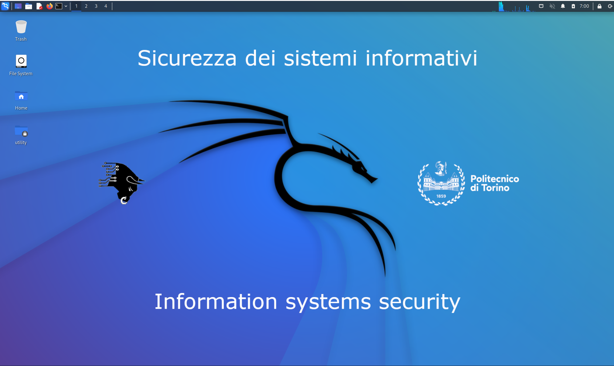
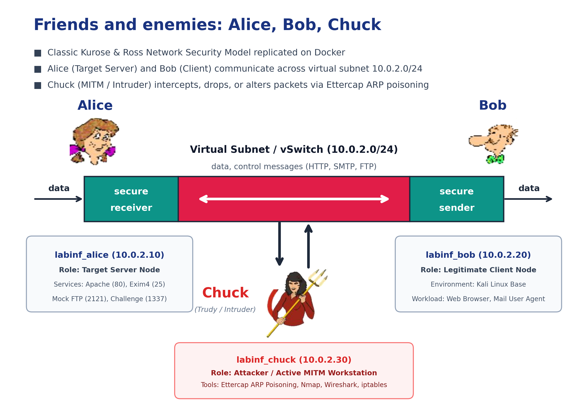
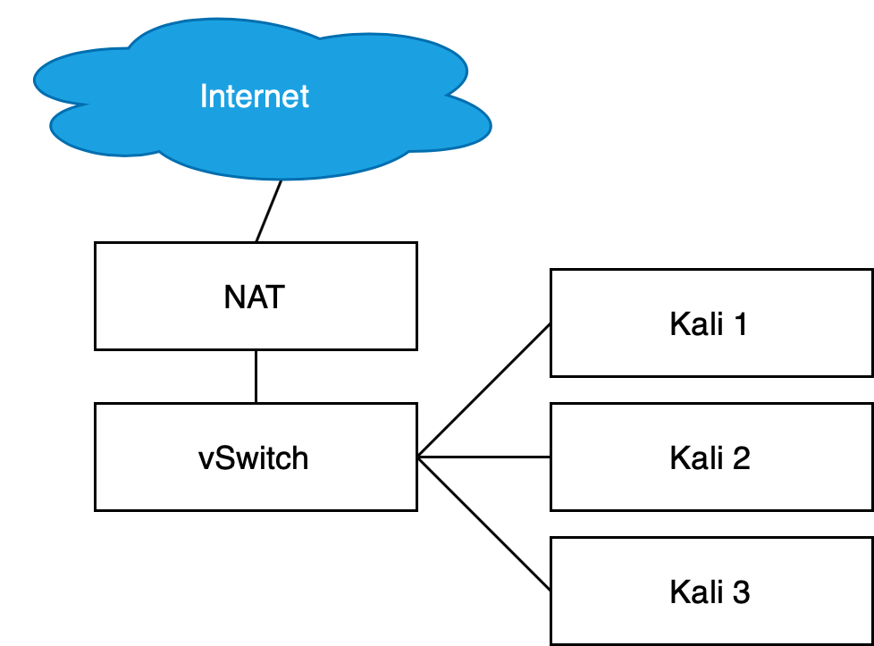

# Politecnico di Torino — LABINF Multi-Node Cybersecurity Environment

[](https://github.com/Beccaceci/polito-ssi-labinf)
[](https://www.kali.org/)
[](https://github.com/Beccaceci/polito-ssi-labinf)
[](https://opensource.org/licenses/MIT)
[](https://www.polito.it/)

<p align="center">
  
</p>

A lightweight, multi-node containerized environment designed to accurately replicate the **LABINF** cybersecurity laboratories for the **Information Systems Security (01UDUOV)** course at **Politecnico di Torino** (Prof. Cataldo Basile).

It enables students on **any operating system (macOS, Windows, Linux)** to perform real Layer 2 network attacks (ARP cache poisoning with Ettercap, packet sniffing, credential harvesting), firewalling experiments (`iptables`/`nftables`), cryptographic analysis, and `IPsec`/`TLS` tunneling without having to run 3 heavy virtual machines simultaneously.

---

## 🧭 Quick Navigation: Choose Your Operating System

Select your operating system to jump directly to the step-by-step setup instructions:

| Operating System | Architecture | Scripting Layer | Quick Link |
| :--- | :--- | :--- | :--- |
| 🍎 **macOS** | Apple Silicon (M1–M4) & Intel | `labinf.sh` (Zsh / Bash) | [**👉 Jump to macOS Guide**](#-macos-guide-apple-silicon--intel) |
| 🪟 **Windows** | Windows 10 & 11 (x86_64 & ARM64) | `labinf.ps1` (PowerShell) / `labinf.bat` | [**👉 Jump to Windows Guide**](#-windows-guide-10--11) |
| 🐧 **Linux** | Ubuntu, Debian, Fedora, Arch | `labinf.sh` (Bash) | [**👉 Jump to Linux Guide**](#-linux-guide-ubuntudebianfedorarch) |

---

## 🏗️ Core Architecture & Topology

### Friends and Enemies: The Kurose & Ross Scenario on Docker

To provide maximum pedagogical clarity, the simulation environment is designed and illustrated following the classic **Jim Kurose & Keith Ross** network security paradigm (*Computer Networking: A Top-Down Approach*), mapping the roles of **Alice**, **Bob**, and **Chuck** (*Trudy*) directly onto the laboratory infrastructure:

<p align="center">
  
</p>
<p align="center">
  <em>Figure 1: Complete simulation topology modeled in the iconic Kurose & Ross textbook style, mapping directly to the LABINF Docker subnet <code>10.0.2.0/24</code>.</em>
</p>

### Official LABINF Guidelines vs. Simulation Architecture

In the official course guidelines (*Istruzioni per il laboratorio*), the laboratory is originally specified as a multi-node virtual local area network (VLAN) connected through a **Virtual Switch (vSwitch)** behind a NAT gateway:

<p align="center">
  
</p>
<p align="center">
  <em>Figure 2: Official LABINF multi-node layout (from course instructions) connecting Kali nodes to a virtual switch behind a NAT gateway.</em>
</p>

### Direct Mapping to Course Laboratories

Rather than launching 3 resource-heavy VirtualBox VMs (consuming 8–12 GB of RAM), this Docker stack reproduces the exact same network topology in less than **1.5 GB of RAM**:

| Official Lab Node | Kurose Character | Simulation Container | IP Address | Subnet / Role |
| :--- | :---: | :--- | :--- | :--- |
| **vSwitch & NAT** | 🌐 *vSwitch* | Docker Bridge `secnet` | `10.0.2.1` | Isolated Layer 2 broadcast domain (`10.0.2.0/24`) |
| **Node A (Kali 1)** |  | Compose service `alice` | `10.0.2.10` | **Target Server** (SSH 22, Apache HTTP 80, Exim4 SMTP 25, mock FTP prompt 21/2121, challenge 1337) |
| **Node B (Kali 2)** |  | Compose service `bob` | `10.0.2.20` | **Legitimate Client** (traffic generator, browser & mail user agent) |
| **Node C (Kali 3)** |  | Compose service `chuck` | `10.0.2.30` | **Attacker / Active MITM** (Ettercap ARP Poisoning, Nmap, Wireshark, iptables) |

The simulation architecture is identical and invariant across all host operating systems. The nodes run inside isolated Docker containers connected by the isolated virtual bridge subnet `10.0.2.0/24`:

```text
                       +-------------------------+
                       |     Virtual Gateway     |
                       |        10.0.2.1         |
                       +------------+------------+
                                    |
            +-----------------------+-----------------------+
            |                       |                       |
+-----------v-----------+   +-------v-------+   +-----------v-----------+
|      alice            |   |      bob      |   |       chuck           |
|       10.0.2.10       |   |   10.0.2.20   |   |       10.0.2.30       |
|                       |   |               |   |                       |
|   Target Server:      |   |   Client:     |   |   Attacker / MITM:    |
|   • Apache HTTPD (80) |   |   • Kali Base |   |   • Kali Security     |
|   • Exim4 SMTP (25)   |   |   • User Bob  |   |   • Nmap / Ettercap   |
|   • Mock FTP (21/2121)|   |               |   |   • iptables / IPsec  |
|   • Challenge (1337)  |   |               |   |   • Wireshark Suite   |
+-----------+-----------+   +-------+-------+   +-----------+-----------+
            |                       |                       |
            +-----------------------+-----------------------+
                                    |
                 +------------------v------------------+
                 |       Shared Host Folder            |
                 |          ./workspace/               |
                 |  (PCAP captures, scripts, keys)     |
                 +-------------------------------------+
```

### Key Architectural Capabilities
1. **Network Namespace Isolation (`secnet` 10.0.2.0/24)**:
   -  **Alice (`alice` — 10.0.2.10)**: Target server hosting Apache HTTP, Exim4 Mail Transfer Agent, and Lab 01 test daemons. Represents the destination or "secure receiver".
   -  **Bob (`bob` — 10.0.2.20)**: Legitimate client machine used to generate traffic, log in to services, and send emails across the network.
   -  **Chuck (`chuck` — 10.0.2.30)**: Security analyst and attacker workstation (the "Trudy" intruder in Kurose's model) equipped with the Kali security suite.
2. **Network Capabilities**:
   Alice and Bob receive `NET_ADMIN` and `NET_RAW`; Chuck runs privileged with these capabilities and `net.ipv4.ip_forward=1` for the network exercises. Alice provides an SSH account (`alice`/`alice`) for the Lab 01 cleartext authentication exercise. Use `labinf-ettercap` from Chuck for MITM commands: Ettercap disables kernel forwarding on startup, and this launcher keeps it enabled so intercepted traffic can continue through Chuck.
3. **Shared Host Volume (`./workspace`)**:
   The local folder `./workspace` is mounted directly into `/home/kali/workspace` on Bob and Chuck, and into `/workspace` on Alice.
   - Capture packets on Chuck: `tcpdump -i eth0 -w /home/kali/workspace/capture.pcap`
   - The file is immediately available on your host computer to inspect using your native host Wireshark.
4. **On-Demand Web GUI Desktop (Port 6080)**:
   For tools requiring a graphical interface (Wireshark GUI, Ettercap GTK), Chuck embeds an on-demand lightweight desktop accessible via any modern web browser at `http://localhost:6080/vnc.html` without needing to install or configure X11/XQuartz/VcXsrv servers on the host.

For the Lab 01 ARP MITM exercise, replace the executable in the handout's command with the compatibility launcher while keeping the same options and targets. For example:

```bash
labinf-ettercap -T -M arp /10.0.2.10// /10.0.2.20//
```

---

## 🍎 macOS Guide (Apple Silicon & Intel)

### 1. Prerequisites
- Install **[Docker Desktop for Mac](https://www.docker.com/products/docker-desktop/)**.
- *Apple Silicon (M1/M2/M3/M4) users*: In Docker Desktop Settings → General, ensure **"Use Virtualization framework"** and **"Use Rosetta for x86/amd64 emulation on Apple Silicon"** are checked.

### 2. Setup & Launch
Open Terminal and run:
```bash
# Clone the repository
git clone https://github.com/Beccaceci/polito-ssi-labinf.git
cd polito-ssi-labinf

# Ensure the launcher has execution rights
chmod +x labinf.sh

# Start the environment
./labinf.sh start
```

### 3. Access Node Terminals
```bash
./labinf.sh chuck   # Attacker shell (Kali Linux)
./labinf.sh bob     # Client shell
./labinf.sh alice   # Server shell
```

### 4. Graphical Analysis (Wireshark GUI)
- **Method A (Recommended — Native Host Wireshark)**:
  Run packet capture in Chuck saving to `/home/kali/workspace/capture.pcap`. Open the file directly with Wireshark installed on macOS for fluid 120Hz Retina rendering.
- **Method B (Web Desktop in Browser)**:
  ```bash
  ./labinf.sh gui
  ```
  This starts the embedded desktop and opens `http://localhost:6080/vnc.html` in your default browser.

---

## 🪟 Windows Guide (10 & 11)

### 1. Prerequisites
- Install **[Docker Desktop for Windows](https://www.docker.com/products/docker-desktop/)** with the **WSL 2 backend** enabled.
- If WSL 2 is not yet installed on your system, open PowerShell as Administrator and run:
  ```powershell
  wsl --update
  ```
  Then restart your PC if prompted.

### 2. Execution Policy Setup (PowerShell)
By default, Windows may restrict running local PowerShell scripts. You can permit script execution for the current session by running:
```powershell
Set-ExecutionPolicy -Scope Process -ExecutionPolicy Bypass
```

### 3. Setup & Launch
Open PowerShell or Windows Terminal:
```powershell
# Clone the repository
git clone https://github.com/Beccaceci/polito-ssi-labinf.git
cd polito-ssi-labinf

# Launch the interactive manager
.\labinf.ps1
```
Or start directly via command-line arguments:
```powershell
.\labinf.ps1 start
```
*(Tip: You can also use `labinf start` via Command Prompt `cmd.exe` through the included `labinf.bat` wrapper!)*

### 4. Access Node Terminals
```powershell
.\labinf.ps1 chuck   # Attacker shell (Kali Linux)
.\labinf.ps1 bob     # Client shell
.\labinf.ps1 alice   # Server shell
```

### 5. Graphical Analysis (Wireshark GUI)
- **Method A (Recommended — Native Windows Wireshark)**:
  Inspect captures saved in `.\workspace\capture.pcap` with your native Windows Wireshark.
- **Method B (Web Desktop in Browser)**:
  ```powershell
  .\labinf.ps1 gui
  ```
  This launches the web desktop and opens Microsoft Edge/Chrome at `http://localhost:6080/vnc.html`.
- **Method C (Windows 11 WSLg)**:
  If you are running Windows 11 with WSLg, launching `wireshark &` from inside Chuck will seamlessly open the graphical window directly on your Windows desktop.

---

## 🐧 Linux Guide (Ubuntu, Debian, Fedora, Arch)

### 1. Prerequisites
- Install Docker Engine and the Docker Compose plugin:
  ```bash
  # Ubuntu / Debian
  sudo apt-get update && sudo apt-get install -y docker.io docker-compose-v2
  sudo usermod -aG docker $USER
  newgrp docker
  ```
- Ensure the Docker daemon is active:
  ```bash
  sudo systemctl enable --now docker
  ```

### 2. Setup & Launch
```bash
git clone https://github.com/Beccaceci/polito-ssi-labinf.git
cd polito-ssi-labinf
chmod +x labinf.sh

./labinf.sh start
```

### 3. Access Node Terminals
```bash
./labinf.sh chuck   # Attacker shell (Kali Linux)
./labinf.sh bob     # Client shell
./labinf.sh alice   # Server shell
```

### 4. Graphical Analysis (Wireshark GUI)
- **Method A (Native Host Wireshark)**: Open `workspace/capture.pcap` directly with your Linux desktop Wireshark.
- **Method B (In-Browser Desktop)**:
  ```bash
  ./labinf.sh gui
  ```
  Opens `http://localhost:6080/vnc.html` in your default browser.
- **Method C (Native X11 Forwarding)**:
  Export your display if you want X11 applications to render on your native desktop:
  ```bash
  xhost +local:docker
  ```

---

## 💻 CLI & Interactive TUI Reference

Running `./labinf.sh` (macOS/Linux) or `.\labinf.ps1` (Windows) without arguments opens an interactive color menu:

```text
==================================================================
   POLITECNICO DI TORINO — SICUREZZA DEI SISTEMI INFORMATIVI
             LABINF Docker Multi-Node Environment
==================================================================
 [1]  🚀 Start environment (Alice, Bob, Chuck)
 [2]  🔴 Chuck Shell (Attacker / Kali Linux Suite)
 [3]  🔵 Bob Shell (Legitimate Client)
 [4]  🟢 Alice Shell (Target Server)
 [5]  🩺 Verify tools and network connectivity
 [6]  📊 Status of containers and IP addresses
 [7]  🔨 Build / Pull images
 [8]  🛑 Stop environment
 [9]  ✉️  Read Alice's mailbox (Lab 01)
 [10] 🌐 Launch Web GUI (Wireshark in browser: http://localhost:6080)
 [0]  ❌ Exit
==================================================================
```

### Command-Line Arguments (Scriptable)

| macOS / Linux | Windows (PowerShell) | Windows (CMD) | Description |
| :--- | :--- | :--- | :--- |
| `./labinf.sh start` | `.\labinf.ps1 start` | `labinf start` | Starts all nodes and creates subnet `10.0.2.0/24` |
| `./labinf.sh stop` | `.\labinf.ps1 stop` | `labinf stop` | Stops and removes containers (preserves images) |
| `./labinf.sh restart` | `.\labinf.ps1 restart` | `labinf restart` | Restarts all containers |
| `./labinf.sh status` | `.\labinf.ps1 status` | `labinf status` | Displays container status and IP addresses |
| `./labinf.sh verify` | `.\labinf.ps1 verify` | `labinf verify` | Verifies node health, required tools, network links, and Alice's services; exits with failure when a check fails |
| `./labinf.sh chuck` | `.\labinf.ps1 chuck` | `labinf chuck` | Spawns interactive bash shell inside Chuck |
| `./labinf.sh bob` | `.\labinf.ps1 bob` | `labinf bob` | Spawns interactive bash shell inside Bob |
| `./labinf.sh alice` | `.\labinf.ps1 alice` | `labinf alice` | Spawns interactive bash shell inside Alice |
| `./labinf.sh gui` | `.\labinf.ps1 gui` | `labinf gui` | Launches in-browser Web GUI on port 6080 |
| `./labinf.sh gui-stop`| `.\labinf.ps1 gui-stop`| `labinf gui-stop`| Stops the Web GUI server |
| `./labinf.sh read_email`| `.\labinf.ps1 read_email`| `labinf read_email`| Inspects Alice's mailbox (`/var/mail/alice`) |
| `./labinf.sh build` | `.\labinf.ps1 build` | `labinf build` | Builds images locally |
| `./labinf.sh pull` | `.\labinf.ps1 pull` | `labinf pull` | Pulls prebuilt multi-arch images from GHCR |

---

## 📚 Course Laboratory Coverage

| Laboratory | Core Topics | Environment Support & Fidelity |
| :--- | :--- | :--- |
| **Lab 01: Network Attacks** | Nmap scans, ARP poisoning, HTTP/SMTP sniffing, challenge discovery. | **Supported baseline**: three nodes, SSH, Apache, Exim, mock FTP prompt, challenge service, and ARP MITM forwarding through `labinf-ettercap`. Automated tests cover the service paths, SMTP delivery, and poisoned HTTP relay. DNS spoofing and remote-browser plugin behavior are not yet covered. |
| **Lab 02: Core Cryptography** | OpenSSL ciphers, RSA/ECC, hashes, brute-force inputs, performance. | **Tooling only**: crypto tools are installed on Kali; course support archives and exercise inputs are not bundled or verified. |
| **Lab 03: Applied Cryptography** | MAC/HMAC, AEAD, PKI, certificates, CRL. | **Tooling only**: OpenSSL is installed; the course AEAD script and exercise acceptance tests are not included. |
| **Lab 04: Firewalling** | Personal firewall, stateless/stateful filtering, NAT, DMZ routing, forwarding. | **Partial**: container firewall tools and capabilities are available; the routed Alice–Frank–Bob topology is not implemented. |
| **Lab 05: IPsec & TLS** | StrongSwan, IPsec policies and associations, TLS handshakes and performance. | **Tooling only**: relevant command-line packages are installed; supplied StrongSwan material and end-to-end tests are not included. |

---

## 🔧 Troubleshooting & FAQ

<details>
<summary><b>1. Error: Docker daemon is not running</b></summary>

- **macOS / Windows**: Launch Docker Desktop from your Applications / Start Menu and wait until the status indicator turns green ("Engine running").
- **Linux**: Run `sudo systemctl start docker` and ensure your user is part of the `docker` group (`sudo usermod -aG docker $USER`).
</details>

<details>
<summary><b>2. Windows PowerShell: "Execution of scripts is disabled on this system"</b></summary>

Run the following command in PowerShell to bypass the restriction for your current terminal:
```powershell
Set-ExecutionPolicy -Scope Process -ExecutionPolicy Bypass
```
Alternatively, execute commands via the Command Prompt (`cmd.exe`) using `labinf.bat`.
</details>

<details>
<summary><b>3. Port 6080 already in use</b></summary>

The web desktop binds to `127.0.0.1` only. If host port 6080 is in use, set `LABINF_GUI_HOST_PORT` before starting (for example, `LABINF_GUI_HOST_PORT=6081 ./labinf.sh start` on macOS/Linux, or `$env:LABINF_GUI_HOST_PORT=6081` in PowerShell):
```yaml
ports:
  - "127.0.0.1:6081:6080"
```
Then access `http://localhost:6081/vnc.html`.
</details>

<details>
<summary><b>4. File permission differences in <code>./workspace</code></b></summary>

Files created by containers inside `./workspace` are owned by the `kali` user (UID 1000). On Linux, if you cannot edit files created inside the container from your host, run:
```bash
sudo chown -R $USER:$USER ./workspace
```
On macOS and Windows, Docker automatically translates host user permissions transparently.
</details>

---

## 🤝 Contributing
Issues, questions, and pull requests are warmly welcome! If you encounter an incompatibility with a specific lab exercise, please open an issue describing your host OS, Docker version, and exercise step.

---

## 📄 License
This project is open-source and released under the [MIT License](LICENSE).
